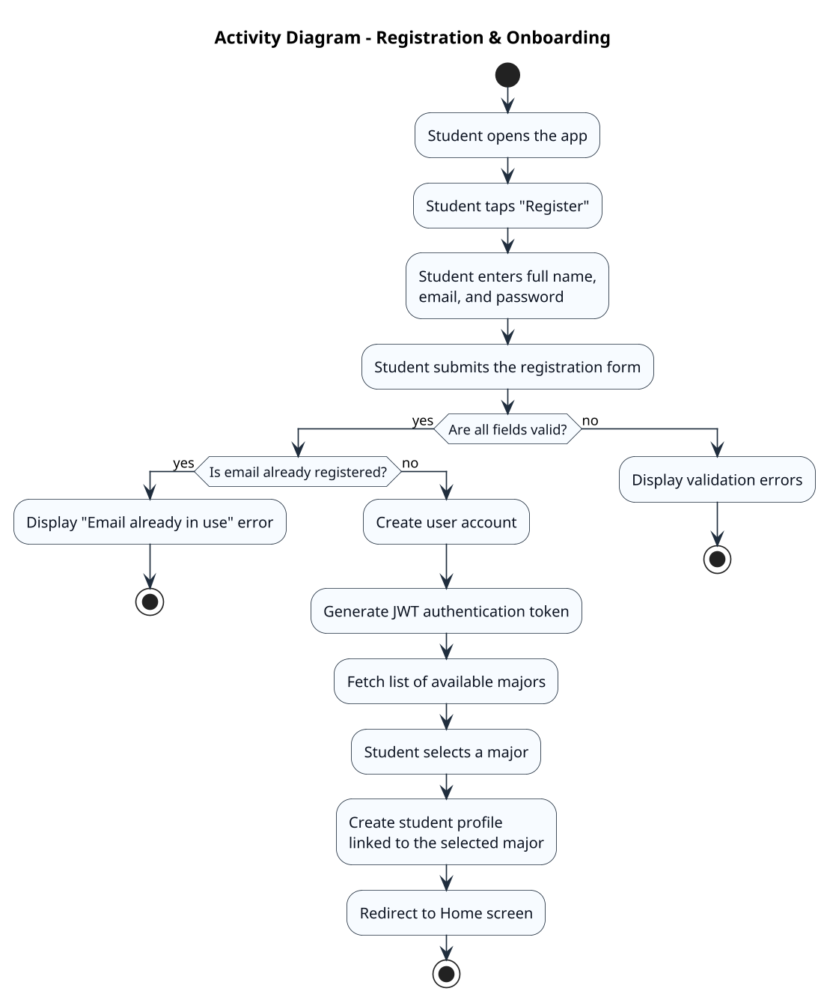
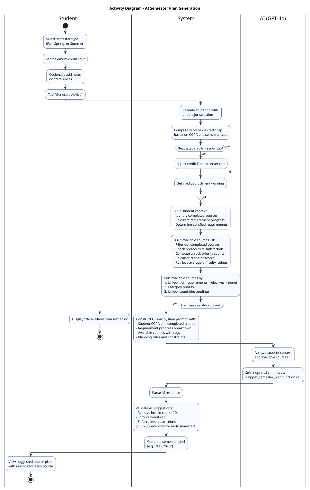
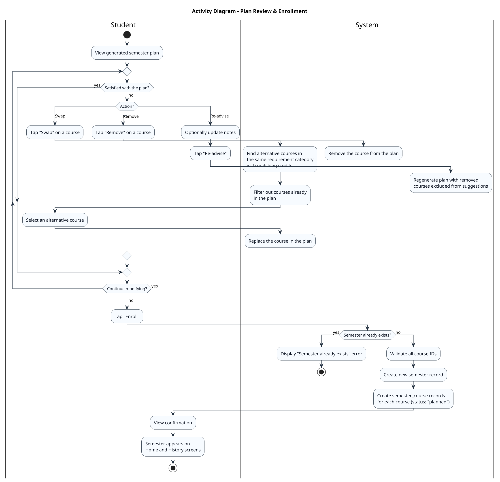
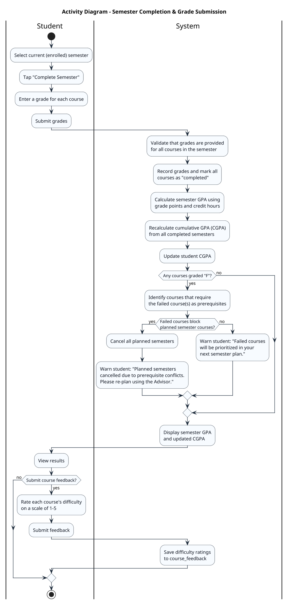

# Smart Course Advisor – Activity Diagrams

The following activity diagrams illustrate the four core workflows of the Smart Advisor system. Together, they trace the complete student journey: entering the system, receiving AI-powered advice, acting on it, and recording outcomes. Each diagram maps directly to use cases defined in the Use Case Diagram and exercises entities from the Entity Relationship Diagram.

| Diagram | Story Role | Use Cases Covered | ERD Entities Touched |
|---------|-----------|-------------------|---------------------|
| Registration & Onboarding | Beginning | Register, Select Major | user, student, major |
| AI Semester Plan Generation | Climax | Generate Semester Plan | student, course, prerequisite, requirement, requirement_course, course_feedback |
| Plan Review & Enrollment | Resolution | Modify Course Selection, Enroll in Suggested Plan | semester, semester_course, course |
| Semester Completion | Consequence | Submit Semester Grades, Submit Course Feedback | semester, semester_course, course_feedback, student (CGPA) |

---

## 1. Registration & Onboarding

This diagram covers the student's entry into the system. It maps to the **Register** and **Select Major** use cases, where registration always includes major selection (the `<<include>>` relationship from the Use Case Diagram). The flow touches the `user`, `student`, and `major` entities from the ERD.

---

## 2. AI-Powered Semester Plan Generation

This diagram covers the system's core feature: AI-driven course planning. It maps to the **Generate Semester Plan** use case and exercises the largest number of ERD entities: `student`, `course`, `prerequisite`, `requirement`, `requirement_course`, and `course_feedback`. The flow illustrates how the system builds a rich academic context, applies business rules (credit caps, prerequisite checks, unlock priority), and delegates final course selection to GPT-4o via function calling.

---

## 3. Plan Review & Enrollment

This diagram covers the student's interaction with the generated plan before committing to it. It maps to the **Modify Course Selection** and **Enroll in Suggested Plan** use cases (both `<<extend>>` from Generate Semester Plan in the Use Case Diagram). The flow shows the decision loop where a student can swap courses, remove courses, re-advise, or enroll — touching the `semester`, `semester_course`, and `course` entities from the ERD.

---

## 4. Semester Completion & Grade Submission

This diagram covers the end-of-semester workflow, mapping to the **Submit Semester Grades** and **Submit Course Feedback** use cases (linked by an `<<extend>>` relationship in the Use Case Diagram). It contains the richest branching logic in the system: GPA calculation, failure detection, and conditional cancellation of future planned semesters. The flow exercises the `semester`, `semester_course`, `course_feedback`, and `student` (CGPA) entities from the ERD.

---

## Diagrams Not Included

The following use cases were intentionally excluded from the activity diagrams as they involve straightforward read or update operations without meaningful decision logic. Their behavior is fully described by the textual use case descriptions:

- **Sign In** — Simple credential validation and JWT token generation.
- **View All Semesters** — A read-only query that groups semesters by status.
- **View Academic Dashboard** — A read-only aggregation of CGPA, progress, and active semester.
- **Update Semester Status** — A single status transition (planned to enrolled) with prerequisite validation.
- **Change Major** — A single-field update on the student profile.
