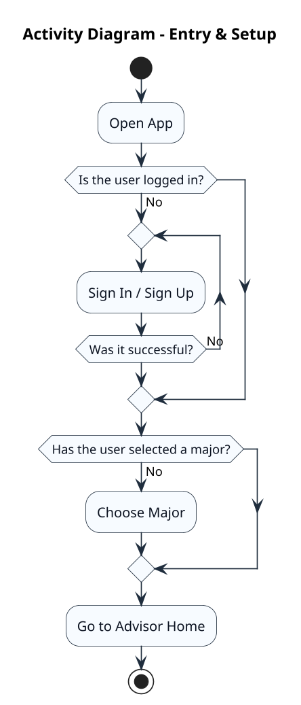
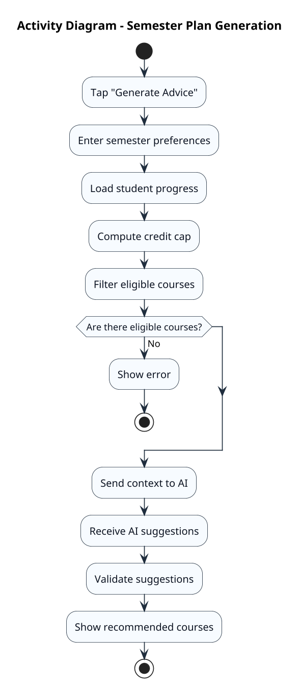
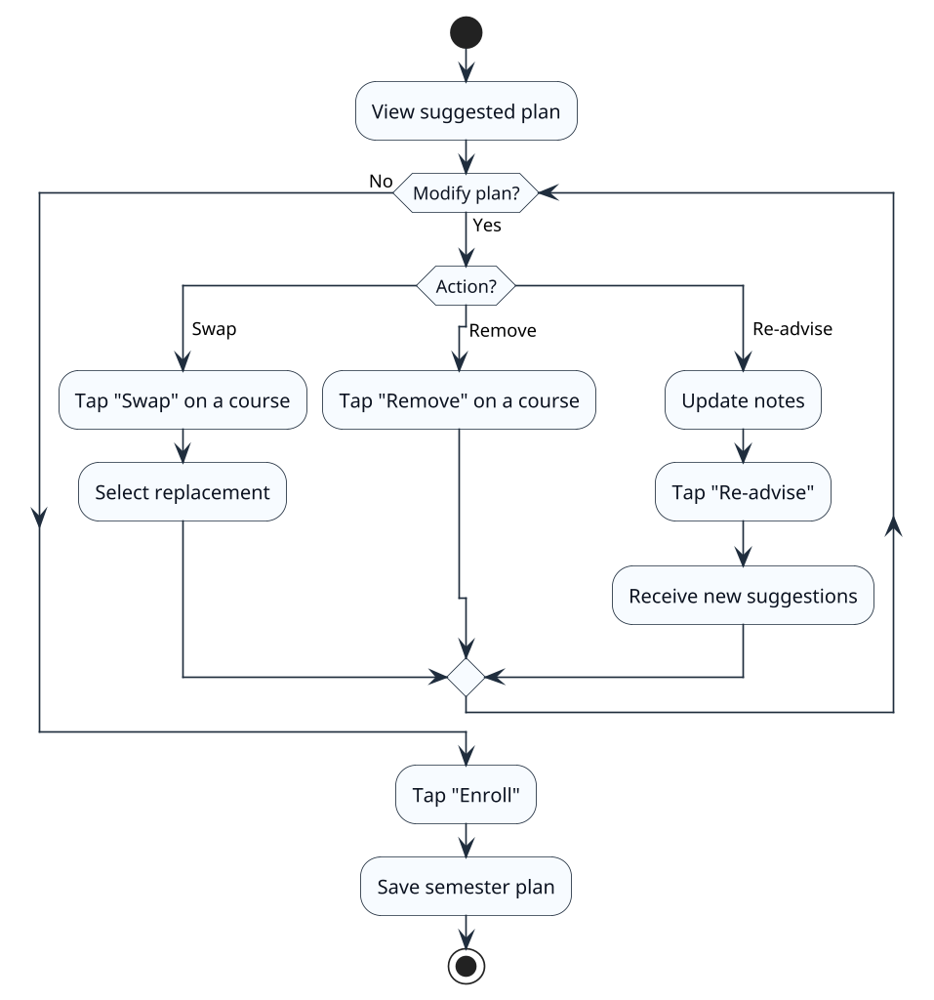
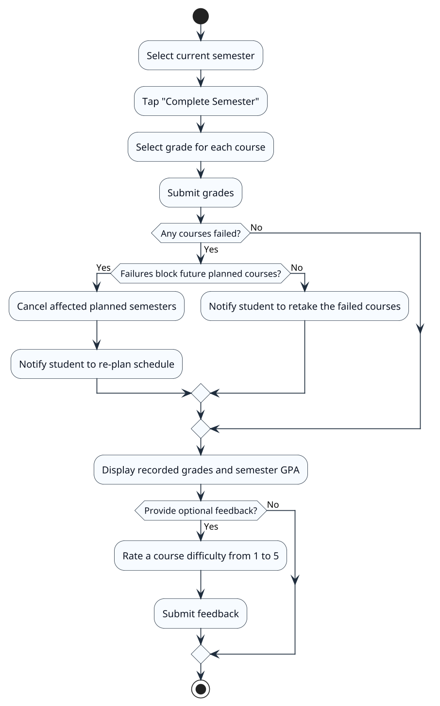

# Smart Course Advisor – Activity Diagrams

The following activity diagrams illustrate the four core workflows of the Smart Advisor system. Together, they trace the complete student journey: entering the system, receiving AI-powered advice, acting on it, and recording outcomes. Each diagram maps directly to use cases defined in the Use Case Diagram and exercises entities from the Entity Relationship Diagram.

| Diagram                  | Story Role  | Use Cases Covered                                 | ERD Entities Touched                                                            |
| ------------------------ | ----------- | ------------------------------------------------- | ------------------------------------------------------------------------------- |
| Entry & Setup            | Beginning   | Register, Sign In, Select Major                   | user, student, major                                                            |
| Semester Plan Generation | Climax      | Generate Semester Plan                            | student, course, prerequisite, requirement, requirement_course, course_feedback |
| Plan Review & Enrollment | Resolution  | Modify Course Selection, Enroll in Suggested Plan | semester, semester_course, course                                               |
| Semester Completion      | Consequence | Submit Semester Grades, Submit Course Feedback    | semester, semester_course, course_feedback, student (CGPA)                      |

---

## 1. Entry & Setup

This diagram shows how a student enters the system. It combines authentication and onboarding into a single flow — the student either signs in or registers, then selects a major if they haven't already, before reaching the Advisor Home screen.

---

## 2. Semester Plan Generation

This diagram illustrates the AI-driven course planning process. The student configures their semester preferences, the system determines which courses are eligible based on academic progress and prerequisites, and the AI advisor recommends an optimal course selection within the student's credit limit.

---

## 3. Plan Review & Enrollment

This diagram shows how a student reviews and refines the generated plan before committing to it. The student can swap courses for alternatives, remove unwanted courses, or request a fresh set of suggestions. Once satisfied, they enroll and the semester plan is saved to their record.

---

## 4. Semester Completion & Grade Submission

This diagram shows the end-of-semester workflow. The student submits grades for each course, the system calculates the semester GPA and updates the cumulative GPA. If any courses are failed, the system checks whether those failures affect future planned semesters and responds accordingly. The student may also submit course difficulty feedback to improve future AI recommendations.

---

## Diagrams Not Included

The following use cases were intentionally excluded from the activity diagrams as they involve straightforward read or update operations without meaningful decision logic. Their behavior is fully described by the textual use case descriptions:

- **View All Semesters** — A read-only listing grouped by status.
- **View Academic Dashboard** — A read-only summary of CGPA, progress, and active semester.
- **Update Semester Status** — A status transition with prerequisite validation.
- **Change Major** — A profile update that re-scopes future AI advice.
