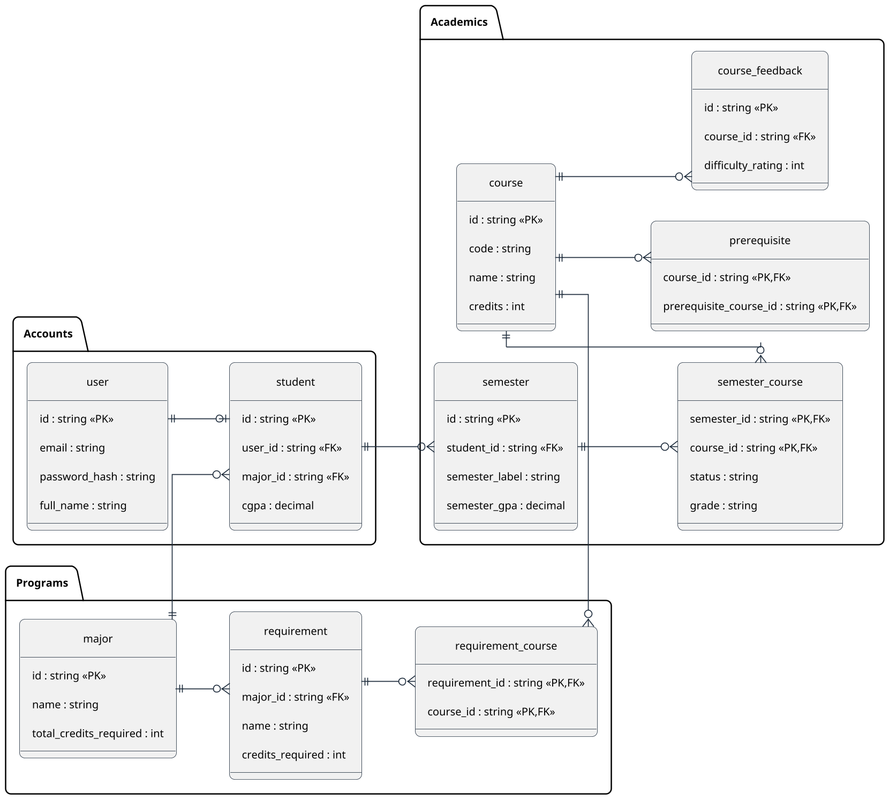

# Smart Course Advisor – Entity Relationship Diagram

The Entity Relationship Diagram (ERD) illustrates the database schema of the Smart Advisor system, organized into three logical groups: Accounts, Programs, and Academics. It defines the data model that supports student authentication, degree program structure, course planning, and academic progress tracking.

## PlantUML Diagram

---

## Description

The Entity Relationship Diagram (ERD) illustrates the database schema of the Smart Advisor system, organized into three logical groups: Accounts, Programs, and Academics.

The **Accounts** group contains the `user` and `student` entities. Each user holds authentication credentials (email and password hash), while the `student` entity extends the user with academic attributes such as CGPA and a foreign key reference to their declared major. A one-to-one relationship exists between `user` and `student`, as each user account corresponds to at most one student profile.

The **Programs** group models the degree structure. A `major` defines the program name and total credits required for graduation. Each major comprises multiple `requirement` categories (e.g., core courses, electives), each specifying the number of credits needed. The `requirement_course` junction table establishes a many-to-many relationship between requirements and courses, defining which courses can fulfill each requirement.

The **Academics** group captures course information and student progress. The `course` entity stores the course code, name, and credit hours. Prerequisites are modeled through a self-referencing many-to-many relationship via the `prerequisite` table, where each entry maps a course to its required prerequisite course. The `semester` entity records a student's enrollment period and semester GPA, while the `semester_course` junction table tracks individual course enrollments within a semester, including the enrollment status and the grade received. Finally, the `course_feedback` entity stores difficulty ratings for courses, which the system uses to inform AI-generated course plan recommendations.

All primary keys use string-based identifiers (UUIDs), and referential integrity is enforced through foreign key constraints across all relationships.

---

## Entity Summary

| Entity | Group | Description |
|--------|-------|-------------|
| **user** | Accounts | Authentication credentials and profile info |
| **student** | Accounts | Academic profile linking a user to a major with cumulative GPA |
| **major** | Programs | Degree program with name and total credits required |
| **requirement** | Programs | A category of courses within a major (e.g., Core, Electives) with required credits |
| **requirement_course** | Programs | Junction table mapping courses to requirements (many-to-many) |
| **course** | Academics | Course catalog entry with code, name, and credit hours |
| **semester** | Academics | A student's semester record with label and GPA |
| **semester_course** | Academics | Enrollment record linking a course to a semester with status and grade |
| **prerequisite** | Academics | Self-referencing relationship defining course prerequisites |
| **course_feedback** | Academics | Student-submitted difficulty rating for a course |

## Relationships Summary

| Relationship | Type | Description |
|--------------|------|-------------|
| user → student | One-to-One | Each user has at most one student profile |
| major → student | One-to-Many | A major has many students enrolled |
| major → requirement | One-to-Many | A major defines multiple requirement categories |
| requirement → requirement_course | One-to-Many | A requirement is fulfilled by multiple courses |
| course → requirement_course | One-to-Many | A course can satisfy multiple requirements |
| student → semester | One-to-Many | A student has multiple semesters |
| semester → semester_course | One-to-Many | A semester contains multiple course enrollments |
| course → semester_course | One-to-Many | A course appears in multiple semester enrollments |
| course → prerequisite | One-to-Many | A course can have multiple prerequisites |
| course → course_feedback | One-to-Many | A course can receive multiple feedback ratings |
