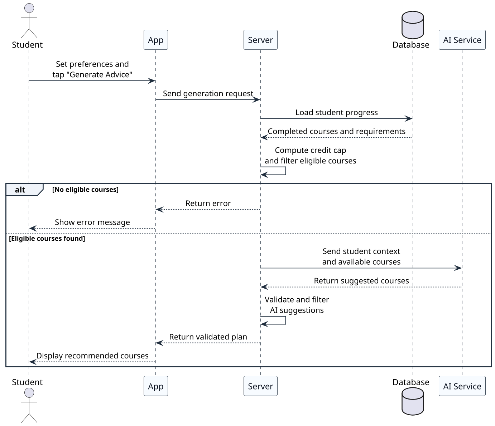
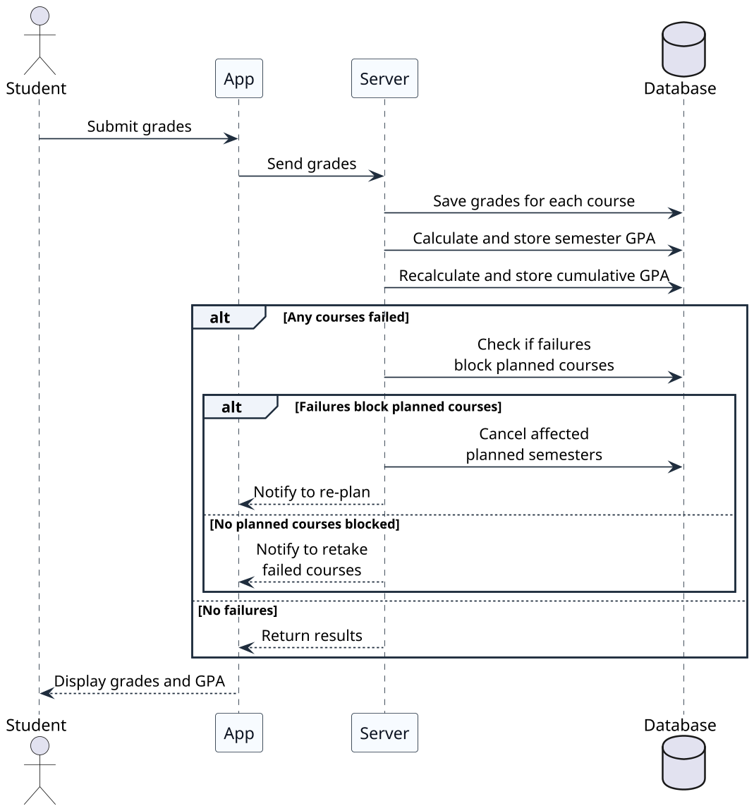

# Smart Course Advisor – Sequence Diagrams

The following sequence diagrams show how the system's components communicate during the two most complex workflows. They complement the activity diagrams by revealing which component is responsible for each step and how data flows between the frontend, backend, AI service, and database.

| Diagram | Why it needs a sequence diagram |
|---------|-------------------------------|
| Semester Plan Generation | The only flow involving five participants — the AI service interaction and server-side validation are not visible in other diagrams |
| Semester Completion | Multiple cascading database operations and conditional side effects that the activity diagram shows as flat steps |

---

## 1. Semester Plan Generation

This diagram traces how a course plan moves from student input to AI recommendation to validated output. The server enriches the request with academic context before consulting the AI, then validates and filters the AI's response before returning it to the student.

---

## 2. Semester Completion

This diagram shows the chain of operations triggered when a student submits grades. The server saves grades, recalculates GPAs, and then checks whether any failed courses create downstream conflicts with future planned semesters.

---

## Diagrams Not Included

The remaining workflows (Entry & Setup, Plan Review & Enrollment) follow simple request-response patterns between the App and Server with no multi-component orchestration. Their interactions are fully captured by the activity diagrams and use case descriptions.
