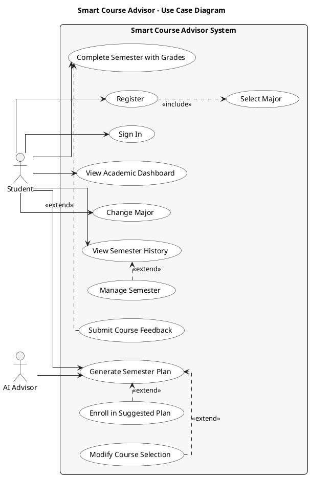

# Smart Course Advisor – Use Case Diagram

## PlantUML Diagram

---

## Use Cases Summary

| Use Case | Description |
|----------|-------------|
| **Register** | Create account (includes Select Major) |
| **Sign In** | Log in with credentials |
| **Select Major** | Choose academic major during onboarding |
| **Generate Semester Plan** | AI creates personalized course plan based on prerequisites, credits, and CGPA |
| **Modify Course Selection** | Swap or remove courses from generated plan (extends Generate) |
| **Enroll in Suggested Plan** | Save plan to academic record (extends Generate) |
| **View Semester History** | See all past, current, and planned semesters |
| **Manage Semester** | Activate or cancel a planned semester (extends View History) |
| **Complete Semester with Grades** | Submit grades and calculate GPA |
| **Submit Course Feedback** | Rate course difficulty after completion (extends Complete) |
| **View Academic Dashboard** | See CGPA, progress, and current semester |
| **Change Major** | Update academic major |

## Actors

| Actor | Description |
|-------|-------------|
| **Student** | Primary user |
| **AI Advisor** | System actor (GPT-4o) for course recommendations |

## Relationships

- `<<include>>`: Register always requires Select Major
- `<<extend>>`: Modify Course Selection and Enroll optionally follow Generate Semester Plan
- `<<extend>>`: Manage Semester optionally follows View Semester History
- `<<extend>>`: Submit Course Feedback optionally follows Complete Semester
