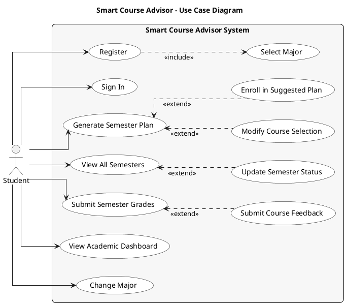

# Smart Course Advisor – Use Case Diagram

## PlantUML Diagram

---

## Use Cases Summary

| Use Case | Description |
|----------|-------------|
| **Register** | Create account (includes Select Major) |
| **Sign In** | Log in with credentials |
| **Select Major** | Choose academic major during onboarding |
| **Generate Semester Plan** | AI creates personalized course plan based on prerequisites, credits, and CGPA |
| **Modify Course Selection** | Swap or remove courses from generated plan |
| **Enroll in Suggested Plan** | Save plan to academic record |
| **View All Semesters** | See all past, current, and planned semesters |
| **Update Semester Status** | Activate or cancel a planned semester |
| **Submit Semester Grades** | Submit grades for current semester and calculate GPA |
| **Submit Course Feedback** | Rate course difficulty after completion |
| **View Academic Dashboard** | See CGPA, progress, and current semester |
| **Change Major** | Update academic major |

## Actors

| Actor | Description |
|-------|-------------|
| **Student** | Primary user who plans courses, tracks progress, and manages semesters |

## Relationships

| Relationship | Type | Description |
|--------------|------|-------------|
| Register → Select Major | include | Registration always requires major selection |
| Modify Course Selection → Generate Semester Plan | extend | Optionally modify after generating plan |
| Enroll in Suggested Plan → Generate Semester Plan | extend | Optionally enroll after generating plan |
| Update Semester Status → View All Semesters | extend | Optionally activate/cancel from semester view |
| Submit Course Feedback → Submit Semester Grades | extend | Optionally rate difficulty after submitting grades |
