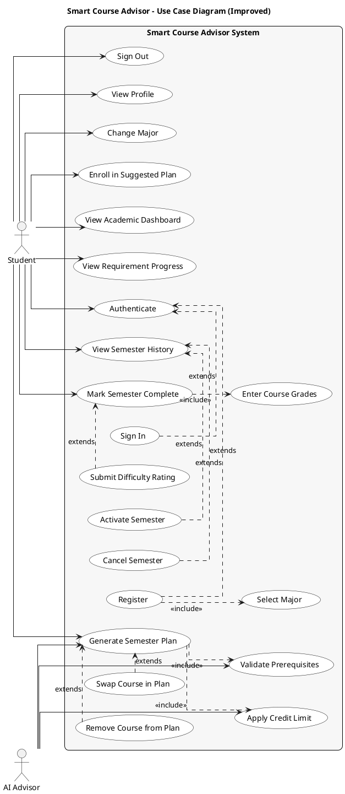
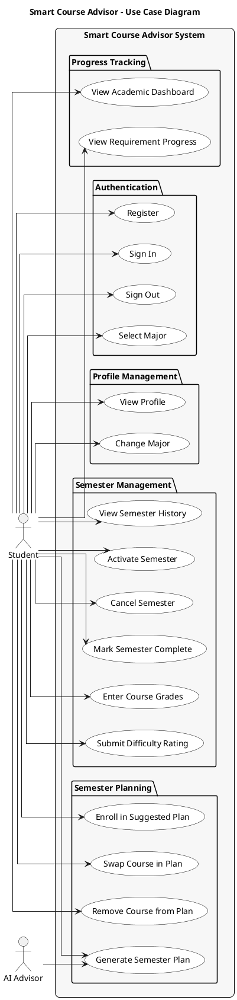

# Smart Course Advisor – Use Case Diagram

## Analysis of Current vs Improved Diagram

### Missing Use Cases Identified

Based on the codebase analysis, the following use cases were missing or could be more explicit:

| Missing Use Case | Why It Matters |
|------------------|----------------|
| **Register** | Separate from Sign In within Authenticate |
| **Sign In** | Explicit login action |
| **Select Major (Onboarding)** | Required step after registration, different from Change Major |
| **Generate Semester Plan** | Core AI feature - more specific than "Request Next-Semester Advice" |
| **Swap Course in Plan** | Distinct from requesting alternatives - actually swapping |
| **Remove Course from Plan** | Exclude courses and regenerate |
| **Activate Semester** | Transition planned → enrolled |
| **Mark Semester Complete** | Submit grades, calculate GPA |
| **Enter Course Grades** | Sub-action of completing semester |
| **Cancel Semester** | Delete a planned semester |
| **View Profile** | Separate from dashboard |
| **Sign Out** | End session |

### Include/Extend Relationships

| Relationship | Type | Rationale |
|--------------|------|-----------|
| Authenticate → Register | extends | Optional path for new users |
| Authenticate → Sign In | extends | Default path for returning users |
| Register → Select Major | include | Required step after registration |
| Generate Semester Plan → Validate Prerequisites | include | System always checks prerequisites |
| Generate Semester Plan → Apply Credit Limit | include | System always enforces credit limits |
| Generate Semester Plan → Swap Course | extends | Optional user action |
| Generate Semester Plan → Remove Course | extends | Optional user action |
| Enroll in Plan → Generate Semester Plan | depends | Must generate before enrolling |
| Mark Semester Complete → Enter Course Grades | include | Required to complete |
| Mark Semester Complete → Submit Difficulty Rating | extends | Optional feedback |
| View Semester History → Activate Semester | extends | Optional action from history |
| View Semester History → Cancel Semester | extends | Optional action from history |

---

## Improved Use Case Diagram

---

## Alternative Simplified Diagram

If include/extend relationships make the diagram too complex, here's a cleaner version with all use cases but fewer relationships:

---

## Use Case Descriptions

### Authentication & Onboarding

| Use Case | Description | Precondition | Postcondition |
|----------|-------------|--------------|---------------|
| Register | Student creates new account with name, email, password | None | Account created, must select major |
| Sign In | Student logs in with credentials | Account exists | Session started |
| Sign Out | Student ends session | Logged in | Session terminated |
| Select Major | Student chooses academic major | Just registered | Major assigned |

### Profile Management

| Use Case | Description | Precondition | Postcondition |
|----------|-------------|--------------|---------------|
| View Profile | View name, email, major, CGPA | Logged in | Profile displayed |
| Change Major | Update academic major | Logged in | Major updated |

### Semester Planning

| Use Case | Description | Precondition | Postcondition |
|----------|-------------|--------------|---------------|
| Generate Semester Plan | AI generates personalized course plan based on prerequisites, credits, CGPA | Logged in, major selected | Plan displayed |
| Swap Course in Plan | Replace suggested course with alternative | Plan generated | Course swapped |
| Remove Course from Plan | Exclude course and regenerate | Plan generated | Plan updated |
| Enroll in Suggested Plan | Save plan to academic record | Plan generated | Semester created (planned status) |

### Semester Management

| Use Case | Description | Precondition | Postcondition |
|----------|-------------|--------------|---------------|
| View Semester History | See all past, current, planned semesters | Logged in | History displayed |
| Activate Semester | Move planned semester to current | Has planned semester | Semester is now "enrolled" |
| Cancel Semester | Delete planned semester | Has planned semester | Semester deleted |
| Mark Semester Complete | Finish current semester with grades | Has current semester | Semester completed, GPA calculated |
| Enter Course Grades | Input grade for each course | Completing semester | Grades recorded |
| Submit Difficulty Rating | Rate course difficulty (1-5) | Course completed | Rating saved for future AI advice |

### Progress Tracking

| Use Case | Description | Precondition | Postcondition |
|----------|-------------|--------------|---------------|
| View Academic Dashboard | See CGPA, progress %, current semester | Logged in | Dashboard displayed |
| View Requirement Progress | Track completion by requirement category | Logged in | Progress bars shown |

---

## Actors

| Actor | Description |
|-------|-------------|
| **Student** | Primary user who plans courses, tracks progress, and manages semesters |
| **AI Advisor** | System actor (GPT-4o) that generates personalized course recommendations |

---

## Notes

- The AI Advisor is a **system actor** that participates in use cases involving course generation
- Include relationships (`<<include>>`) indicate mandatory sub-behaviors
- Extend relationships indicate optional or conditional behaviors
- The Student must authenticate before accessing any other functionality
