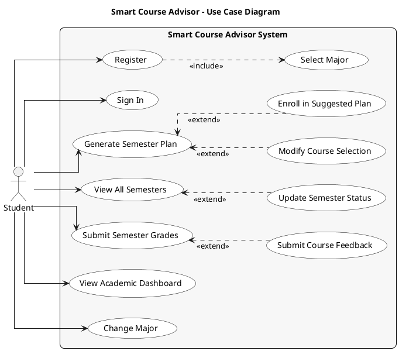

# Smart Course Advisor – Use Case Diagram

The Use Case Diagram showcases the interactions between the Student and the Smart Course Advisor System. It defines the system's functional requirements and clarifies the Student's role. The Student can authenticate, complete onboarding by selecting a major, generate personalized semester plans, view all semesters, submit grades, provide course feedback, view academic progress, and change their major.

## PlantUML Diagram

---

## Use Cases Summary

| Use Case | Description |
|----------|-------------|
| **Register** | Create account (includes Select Major) |
| **Sign In** | Log in with credentials |
| **Select Major** | Choose academic major during onboarding |
| **Generate Semester Plan** | AI creates personalized course plan based on prerequisites, credits, and CGPA |
| **Modify Course Selection** | Swap or remove courses from generated plan |
| **Enroll in Suggested Plan** | Save plan to academic record |
| **View All Semesters** | See all past, current, and planned semesters |
| **Update Semester Status** | Activate or cancel a planned semester |
| **Submit Semester Grades** | Submit grades for current semester and calculate GPA |
| **Submit Course Feedback** | Rate course difficulty after completion |
| **View Academic Dashboard** | See CGPA, progress, and current semester |
| **Change Major** | Update academic major |

## Actors

| Actor | Description |
|-------|-------------|
| **Student** | Primary user who plans courses, tracks progress, and manages semesters |

## Relationships

| Relationship | Type | Description |
|--------------|------|-------------|
| Register → Select Major | include | Registration always requires major selection |
| Modify Course Selection → Generate Semester Plan | extend | Optionally modify after generating plan |
| Enroll in Suggested Plan → Generate Semester Plan | extend | Optionally enroll after generating plan |
| Update Semester Status → View All Semesters | extend | Optionally activate/cancel from semester view |
| Submit Course Feedback → Submit Semester Grades | extend | Optionally rate difficulty after submitting grades |

---

## Textual Use Cases (Recommended Order)

The following order mirrors the student's journey through the app: Authentication → Dashboard → Planning → Management → Profile.

### 1. Register

The system allows a new student to create an account to access the app.

| Field | Value |
|-------|-------|
| **Use Case Name** | Register |
| **Actor** | Student |
| **Pre-condition** | Internet access, student does not have an account |
| **Description** | 1. The student clicks Register and gets redirected to the Sign Up screen. 2. The student enters their full name, email, and password. 3. The student submits the form. 4. The student is prompted to select their major. |
| **Post-condition** | The student has an account, is authenticated, and is redirected to the Home screen. |

### 2. Sign In

The system allows a returning student to sign in to access the app.

| Field | Value |
|-------|-------|
| **Use Case Name** | Sign In |
| **Actor** | Student |
| **Pre-condition** | Internet access, an account exists, and no active session |
| **Description** | 1. The student enters their email and password. 2. The student submits the form. |
| **Post-condition** | The student is authenticated and redirected to the Home screen. |

### 3. View Academic Dashboard

The system displays the student's academic overview including CGPA, graduation progress, and current semester.

| Field | Value |
|-------|-------|
| **Use Case Name** | View Academic Dashboard |
| **Actor** | Student |
| **Pre-condition** | The student is authenticated, has selected a major, and is in the Home screen. |
| **Description** | 1. The student views their: • CGPA badge • Graduation progress percentage • Credits breakdown by requirement category • The active or next planned semesters with their courses. |
| **Post-condition** | The student sees their current academic standing and progress toward graduation. |

### 4. Generate Semester Plan

The system uses AI to generate a personalized course plan for the student's next semester.

| Field | Value |
|-------|-------|
| **Use Case Name** | Generate Semester Plan |
| **Actor** | Student |
| **Pre-condition** | The student is authenticated, has selected a major, has eligible courses remaining, and is in the Advisor screen. |
| **Description** | 1. The student selects a semester (Fall, Spring, or Summer), sets a maximum credit limit, and optionally adds notes or preferences. 2. The student clicks "Generate Advice". 3. The system displays a recommended course plan with reasons for each course. |
| **Post-condition** | A validated AI-generated course plan is displayed to the student with reasons and within the specified credit limit. |

### 5. Modify Course Selection

The student modifies the generated plan by swapping or removing courses.

| Field | Value |
|-------|-------|
| **Use Case Name** | Modify Course Selection |
| **Actor** | Student |
| **Pre-condition** | A semester plan has been generated and is displayed on the Advisor screen. |
| **Description** | **Swap a course:** 1. The student taps "Swap" on a course. 2. The system displays alternative courses. 3. The student selects an alternative. 4. The course is immediately replaced in the plan.  **Remove a course:** 1. The student taps "Remove" on a course. 2. The course is removed from the displayed plan. 3. The student may optionally add notes and tap "Re-advise" to regenerate the plan, filling in the gap left by the removed course(s). |
| **Post-condition** | The semester plan is updated to reflect the student's modifications. |

### 6. Enroll in Suggested Plan

The student confirms and saves the AI-suggested course plan as their upcoming semester.

| Field | Value |
|-------|-------|
| **Use Case Name** | Enroll in Suggested Plan |
| **Actor** | Student |
| **Pre-condition** | A semester plan has been generated and is displayed on the Advisor screen. |
| **Description** | 1. The student taps the "Enroll" button. |
| **Post-condition** | A new planned semester is saved and appears on both the Home screen and the History screen. |

### 7. View All Semesters

The student views all their semesters organized by status.

| Field | Value |
|-------|-------|
| **Use Case Name** | View All Semesters |
| **Actor** | Student |
| **Pre-condition** | The student is authenticated and is on the History screen. |
| **Description** | 1. The student views their semesters organized by status: • Current semester. • Completed semesters with GPA. • Planned future semesters. |
| **Post-condition** | The student sees their complete semester history. |

### 8. Update Semester Status

The student activates or cancels a planned semester.

| Field | Value |
|-------|-------|
| **Use Case Name** | Update Semester Status |
| **Actor** | Student |
| **Pre-condition** | The student is on the History screen and has at least one planned semester. |
| **Description** | 1. The student selects the next planned semester in line. 2. The student chooses to activate or cancel the semester. 3. The system validates prerequisites (if activating) and updates the semester status. |
| **Post-condition** | The semester status is updated to "enrolled" if activated, or the semester is deleted if cancelled. |

### 9. Submit Semester Grades

The student marks a semester as complete and records their grades for each course.

| Field | Value |
|-------|-------|
| **Use Case Name** | Submit Semester Grades |
| **Actor** | Student |
| **Pre-condition** | The student has a current enrolled semester. |
| **Description** | 1. The student selects the current semester. 2. The student taps "Complete Semester". 3. The student enters a grade for each course. 4. The student submits the grades. 5. The system calculates the semester GPA and updates the CGPA. |
| **Post-condition** | The semester is marked as completed with grades recorded and GPA calculated. |

### 10. Submit Course Feedback

The student rates the difficulty of completed courses to improve future AI recommendations.

| Field | Value |
|-------|-------|
| **Use Case Name** | Submit Course Feedback |
| **Actor** | Student |
| **Pre-condition** | The student has just completed a semester. |
| **Description** | 1. The system prompts the student to rate course difficulty. 2. The student rates each course on a scale of 1-5. 3. The student submits the feedback. |
| **Post-condition** | Course difficulty ratings are saved and will influence future AI recommendations. |

### 11. Change Major

The student updates their declared major, re-scoping all future AI advice to the new degree plan.

| Field | Value |
|-------|-------|
| **Use Case Name** | Change Major |
| **Actor** | Student |
| **Pre-condition** | The student is authenticated and is on the Profile screen. |
| **Description** | 1. The student clicks Change Major. 2. The student selects a new major from the list. 3. The student confirms the change. |
| **Post-condition** | The student's major is updated in the system. |
